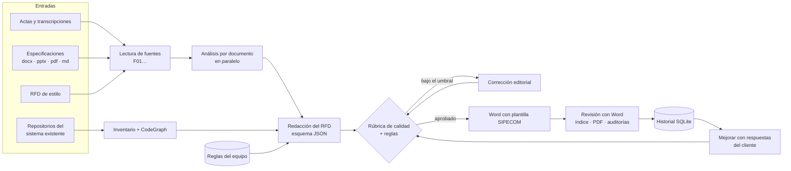

# Generador de RFD · SIPECOM

> Convierte actas, especificaciones, presentaciones y el código de un sistema existente en un **Requerimiento Funcional Detallado (RFD)** en Word con la plantilla SIPECOM: trazable, revisado con una rúbrica de calidad y listo para revisión humana.


---

## Tabla de contenido

- [Qué resuelve](#qué-resuelve)
- [Funcionalidades](#funcionalidades)
- [Arquitectura](#arquitectura)
- [Requisitos](#requisitos)
- [Instalación](#instalación)
- [Uso](#uso)
- [Cómo se genera un RFD](#cómo-se-genera-un-rfd)
- [Calidad narrativa y reglas del equipo](#calidad-narrativa-y-reglas-del-equipo)
- [Preguntas al cliente y mejora del RFD](#preguntas-al-cliente-y-mejora-del-rfd)
- [Línea de comandos](#línea-de-comandos)
- [Estructura del proyecto](#estructura-del-proyecto)
- [Pruebas](#pruebas)
- [Seguridad y privacidad](#seguridad-y-privacidad)
- [Hoja de ruta](#hoja-de-ruta)

---

## Qué resuelve

Redactar un RFD a partir de varias especificaciones, actas y del sistema actual exige cruzar fuentes, detectar contradicciones y mantener un nivel de redacción uniforme. Esta herramienta automatiza ese trabajo sin perder control:

- **El modelo propone, el programa valida.** La salida del modelo se valida contra un esquema JSON; el armado del Word, la numeración, el índice y las auditorías son deterministas.
- **Trazabilidad.** Cada requerimiento cita sus fuentes (`F01 P12`, `F03 T2F4C2`, `F05 Pg3L8`) y cada anexo indica qué RF sustenta.
- **Nada inventado.** Lo que no consta queda como «Por estimar», «Por designar» o «Pendiente»; las contradicciones entre fuentes se registran como definiciones **D-xx** y se convierten en preguntas para el cliente.

## Funcionalidades

| Área | Detalle |
| --- | --- |
| **Entradas** | `.txt`, `.md`, `.docx`, `.pptx` (texto, tablas y notas), `.pdf` (texto por página) y `.xlsx` (cada celda citada como `Hoja!A1`; las fórmulas se conservan como reglas de cálculo para replicarlas). Varias transcripciones y documentos de contexto; la transcripción es opcional. |
| **RFD en avance** | Un RFD a medio redactar (cualquier formato admitido) que la IA continúa: conserva lo ya escrito, completa secciones vacías o por confirmar con las demás fuentes y adopta la estructura y terminología del autor. Las contradicciones con otras fuentes se registran, no se sobrescriben. CLI: `--avance`. |
| **Importar y continuar** | Un RFD en avance (.docx) se importa al historial, marcado «en avance» y con el Word original enlazado. «Continuar» crea la versión siguiente: conserva literalmente lo escrito, completa sólo lo que falta con contexto adicional y una instrucción opcional, y no necesita respuestas del cliente. La revisión editorial no puede reescribir el texto del autor: lo que no cumple la rúbrica se informa como hallazgo. CLI: `importar`, `continuar`. |
| **Referencias de estilo** | RFD aprobados de otros proyectos que sólo orientan estructura y redacción; la revisión avisa si se filtran nombres o datos. |
| **Código existente** | Inventario de una carpeta con varios repositorios (stack, controladores, componentes, servicios, procedimientos almacenados) y código relacionado vía **CodeGraph** o **Repomix**. |
| **CLIs de IA** | Claude Code, Codex, Antigravity (`agy`), Grok y OpenCode, con el listado vivo de modelos de cada CLI y su nivel de esfuerzo. Cada una se aísla de sus propias reglas e instrucciones globales. Informa tokens y, cuando la CLI lo entrega, costo. |
| **Calidad** | Rúbrica calibrada con un RFD aprobado y corrección editorial automática hasta alcanzar el umbral. |
| **Reglas del equipo** | Instrucciones «evitar / exigir» por sección y cliente, inyectadas al modelo y verificadas en el resultado. |
| **Word** | Plantilla SIPECOM, numeración por capítulo, índice actualizado y PDF con Microsoft Word, detección de páginas vacías y de instrucciones de plantilla sin reemplazar. |
| **Preguntas al cliente** | Sección 3.2 del RFD y cuestionario `.docx` para enviar y recibir respondido. |
| **Historial y mejora** | Historial SQLite con versiones; «Mejorar RFD» adapta el documento a las respuestas del cliente **sin rehacerlo** y registra cada cambio. |
| **Interfaz** | Web local (React + TypeScript) con pestañas *Generar*, *Historial y mejoras* y *Reglas*; también CLI completa. |

## Arquitectura



| Capa | Tecnología |
| --- | --- |
| Backend | Python 3.11+, FastAPI, Uvicorn, python-docx / lxml, python-pptx, pypdf |
| Frontend | React 18, TypeScript, Vite (compilado en `generador_rfd/static`, no requiere Node para usar la app) |
| Modelos | Claude Code CLI y Codex CLI en modo aislado (sin herramientas, sin MCP, sin configuración del usuario, sesión efímera) |
| Persistencia | SQLite (`datos/rfd.db`): RFD, versiones, preguntas, respuestas y reglas |
| Revisión | Microsoft Word vía COM (opcional, Windows) |

## Requisitos

- **Python 3.11 o superior.**
- Al menos una CLI de IA con sesión iniciada: [Claude Code](https://docs.claude.com/en/docs/claude-code) (`claude`, luego `/login`), Codex (`codex login`), Antigravity (`agy`), Grok (`grok login`) u OpenCode (`opencode`).
- Opcional: **Microsoft Word** (Windows) para actualizar el índice y exportar PDF.
- Opcional: **CodeGraph** (`npm i -g @colbymchenry/codegraph`) o **Repomix** para analizar el código existente.
- Opcional: **Bun** o Node, sólo para modificar la interfaz web.

## Instalación

```powershell
git clone https://github.com/kevin21sipecom/rfd-sipecom.git
cd rfd-sipecom
make install          # crea .venv e instala la app con dependencias de desarrollo
make doctor           # comprueba CLIs, CodeGraph, plantilla y Word
```

Sin `make`:

```powershell
python -m venv .venv
.venv\Scripts\activate
pip install -e ".[dev]"
generador-rfd doctor
```

## Uso

### Interfaz web

```powershell
make dev              # http://127.0.0.1:2122 y abre el navegador
```

1. **Fuentes:** arrastre actas, especificaciones o presentaciones (y, si quiere, un RFD de referencia de estilo).
2. **Código del proyecto** (opcional): elija la carpeta de los repositorios y revise el contexto que se aportará.
3. **Datos del RFD:** cliente, código, título, fecha y tipo de proyecto.
4. **Motor:** CLI, modelo (listado vivo de esa CLI, con «Otro modelo…» para un ID manual) y esfuerzo. La elección se recuerda por CLI.
5. **Generar RFD:** siga el progreso por pasos y descargue el Word, el PDF, el cuestionario y el informe de revisión.

`Ver demostración sin modelo` genera un RFD ficticio para comprobar el formato.

### Atajos con make

| Objetivo | Acción |
| --- | --- |
| `make help` | Lista los comandos |
| `make install` | Entorno virtual y dependencias (Python y web) |
| `make build` | Compila la interfaz TypeScript |
| `make dev` / `make start` | Inicia la app con o sin navegador |
| `make dev-ui` | Vite con recarga en caliente (proxy a `/api`) |
| `make stop` / `make restart` / `make status` | Gestión del servidor local |
| `make test` / `make test-fast` | Pruebas completas / sin llamar a modelos |
| `make demo` | RFD de demostración |
| `make clean` | Cachés y temporales |

## CLIs de IA

Cada CLI recibe el prompt, entrega la salida estructurada y carga reglas propias de forma distinta; `generador_rfd/motores.py` concentra esas diferencias, siguiendo el contrato de `@sipecom/common-utils` (`agent-cli.ts`).

| CLI | Catálogo de modelos | Prompt | Salida estructurada | Aislamiento de sus reglas |
| --- | --- | --- | --- | --- |
| `claude` | catálogo de la app | stdin | `--json-schema` | sin herramientas, MCP, plugins ni settings (CLAUDE.md fuera); `--system-prompt` |
| `codex` | `codex debug models` | stdin | `--output-schema` | sólo lectura, efímero, `--ignore-user-config`, `--ignore-rules` |
| `agy` | `agy models` | stdin como NDJSON (`--input-format stream-json`) | `--json-schema` | `--sandbox`, `--disable-slash-commands`, carpeta vacía |
| `grok` | `grok models` | `--prompt-file` | `--json-schema` | `--system-prompt-override`, sin subagentes, plan ni web |
| `opencode` | `opencode models --verbose` | stdin | esquema en el prompt + validación | `--pure` y `OPENCODE_DISABLE_*` (CLAUDE.md, skills, config del proyecto) |

El esfuerzo se pasa como `--effort` (claude, agy), `model_reasoning_effort` (codex), `--reasoning-effort` (grok) o `--variant` (opencode). `generador-rfd doctor --proveedor <cli>` muestra la ruta, el aislamiento y el catálogo de cada una.

## Cómo se genera un RFD

1. **Fuentes.** Cada archivo se convierte en texto con marcas de procedencia (`P12` párrafo, `T3F2C1` celda de tabla, `D4` diapositiva, `L8` línea, `Pg3L12` página y línea, `H1F4` hoja 1 fila 4 de un Excel).
2. **Análisis por documento.** Una llamada por fuente, en paralelo: referencias (códigos de especificación y versiones), servicios, datos de solicitud y respuesta, reglas, validaciones, mensajes, dependencias, escenarios, dudas internas y términos para buscar en el código.
3. **Sistema existente.** Inventario de cada repositorio y fragmentos de código relacionados con los temas detectados.
4. **Redacción.** Justificación, objetivo, alcance RF-xx, AS-IS, secciones transversales, una sección por interfaz (descripción, información intercambiada, referencia funcional, flujo y criterios de aceptación), escenarios, adecuaciones por componente, prerrequisitos, definiciones D-xx, restricciones, entregables, esfuerzo, anexos y preguntas para el cliente.
5. **Calidad.** Rúbrica y corrección editorial (ver abajo).
6. **Word.** Plantilla SIPECOM con numeración por capítulo (2.3, 2.3.1) e índice como campo.
7. **Revisión.** Word actualiza el índice y exporta el PDF; se auditan páginas vacías, instrucciones de plantilla y términos heredados de las referencias de estilo.

Salidas en `salidas/`:

| Archivo | Contenido |
| --- | --- |
| `RFD_<código>.docx` / `.pdf` | Documento editable y PDF |
| `RFD_<código>.json` | Datos estructurados que alimentaron el Word |
| `RFD_<código>.analisis.json` | Análisis de cada fuente |
| `RFD_<código>.cuestionario.docx` | Preguntas para el cliente con columna de respuesta |
| `RFD_<código>.revision.md` | Calidad, hallazgos, reglas aplicadas, supuestos y trazabilidad |

## Calidad narrativa y reglas del equipo

**Rúbrica** (`generador_rfd/calidad.py`), calibrada midiendo un RFD aprobado: párrafos de 25-110 palabras, objetivo en infinitivo, AS-IS de 3-5 párrafos, sección transversal que distingue *sin resultados / validación rechazada / falla de comunicación*, por interfaz 2-4 párrafos + referencia funcional + flujo de 4-8 pasos + 4-9 criterios en voz normativa («deberá») con al menos un caso de error, prerrequisitos con responsable, definiciones con evidencia y anexos F-xx → RF. Si el puntaje queda bajo **85 %**, el mismo motor recibe la lista exacta de criterios fallidos y corrige sólo eso (hasta dos rondas; se conserva la mejor versión).

**Reglas del equipo** (pestaña *Reglas* o `generador-rfd reglas`): instrucciones que se agregan a cada llamada al modelo, después de las reglas de integridad.

**Reglas predeterminadas (REG-001 a REG-030).** Provienen del documento *Reglas y correcciones para el generador de RFD* v1.0 y se cargan solas en el historial. Agrupadas en seis observaciones — narrativas internas y autoconfirmaciones, justificaciones por información no disponible, prerrequisitos y asignaciones internas, nombres y datos del operador, decisiones y coordinación internas, y anexos de trabajo — aseguran que el RFD explique la necesidad, las funcionalidades y el alcance **sin** trasladar el proceso interno de elaboración. Se pueden ajustar o desactivar (y restaurar), pero no eliminar. Las que tienen verificación sólo *localizan* frases típicas («no se suministró», «revisión humana», «según la transcripción», CodeGraph…); la corrección la hace el modelo con el contexto completo, de modo que un mecanismo legítimo del cliente (p. ej. tokens de autenticación) se conserva. Con ellas, los anexos quedan vacíos por defecto y el capítulo 8 sólo se imprime si hay anexos del entregable; la trazabilidad fuente → RF queda en el informe interno `*.revision.md`.

- **Evitar / Exigir**, por **sección** (todo, requerimientos, criterios, flujos, esfuerzo, preguntas…) y por **cliente** (vacío = todos).
- **Verificación automática opcional:** términos separados por `|` o una expresión con `re:`. Cada regla verificable es un criterio más de la rúbrica; si persiste el incumplimiento, el informe registra `regla_incumplida` con su ubicación.

```powershell
generador-rfd reglas --agregar "No usar enumeraciones abiertas como etc." --patron "etc.|entre otros"
generador-rfd reglas --agregar "Cada RF incluye un criterio de timeout" --tipo exigir --seccion criterios --patron "timeout|tiempo de espera"
```

## Preguntas al cliente y mejora del RFD

1. Cada RFD incluye **3.2 Preguntas para el cliente** y un cuestionario `.docx`.
2. En **Historial y mejoras** se escriben las respuestas (guardado automático) o se carga el cuestionario respondido; «Pendiente» deja la pregunta abierta.
3. **Mejorar a vX.Y** adapta el RFD: conserva todo lo no afectado, elimina las definiciones resueltas, cierra las preguntas respondidas y sólo agrega preguntas si una respuesta abre un vacío. Cada cambio queda en el registro y la versión se suma al historial del Word.
4. La nueva versión pasa por la rúbrica y la revisión con Word; se avisa si una respuesta no figura en los cambios o si se eliminó un RF.

## Continuar un RFD en avance

1. En **Historial y mejoras**, **Importar proyecto en avance** recibe el `.docx`, el cliente y el código. El modelo sólo reconstruye su estructura; el Word original queda enlazado y la entrada figura como «en avance».
2. En el detalle del RFD, **Continuar** admite documentos de contexto opcionales y una instrucción corta («qué falta o en qué enfocarte»).
3. La IA conserva literalmente lo escrito (textos, IDs, numeración, campos y decisiones), completa secciones vacías, marcadores y «por confirmar», imita la estructura y terminología del autor, registra las contradicciones en *definiciones* y lo que no pueda completar en *pendientes*.
4. Se crea una versión nueva del mismo proyecto; la anterior queda intacta. La revisión editorial recibe el texto del autor y sólo puede ajustar lo que la IA agregó; los criterios que el texto original no cumple aparecen en el informe como `calidad_texto_autor`. Lo mismo vale al generar con un RFD en avance como fuente.

## Línea de comandos

```powershell
generador-rfd generar `
  --contexto .\especificaciones\interfaz-clientes.docx `
  --contexto .\especificaciones\escenarios.pptx `
  --estilo .\referencias\RFD_aprobado.docx `
  --proyecto C:\ruta\a\los\repositorios `
  --cliente "Cliente" --codigo "RFD-001" --tipo-proyecto existente `
  --proveedor claude --modelo claude-sonnet-5-5 `
  --salida .\salidas\RFD_RFD-001.docx

generador-rfd historial
generador-rfd mejorar --id 6 --cuestionario .\respuestas\cuestionario.docx --adjunto .\respuestas\acta.pdf
generador-rfd importar .\avance\RFD_parcial.docx --cliente "Cliente" --codigo "RFD-002"
generador-rfd continuar --id 7 --contexto .\especificaciones\interfaz-clientes.docx --instruccion "Completa los criterios de RF-03 y el esfuerzo"
generador-rfd contexto-codigo --proyecto C:\ruta\al\proyecto --enfoque "registro de pedidos"
generador-rfd renderizar --datos .\ejemplos\rfd_demo.json --salida .\salidas\RFD_DEMO.docx
generador-rfd doctor --proveedor codex
```

`--transcripcion`, `--contexto` (también en `continuar`), `--estilo` y `--adjunto` se pueden repetir; `--sin-word` omite la revisión con Word; `--publico` bloquea el Word si quedan pendientes o datos sin confirmar.

## Estructura del proyecto

```text
generador_rfd/
├── fuentes.py       Lectura de txt, md, docx, pptx y pdf con marcas de procedencia
├── proyecto.py      Inventario de repositorios, CodeGraph y Repomix
├── modelo.py        Invocación aislada de Claude/Codex, prompts de análisis, redacción, corrección y adaptación
├── schema.py        Esquemas JSON, normalización y auditorías de contenido
├── calidad.py       Rúbrica de nivel narrativo
├── reglas.py        Reglas del equipo: bloque de prompt y verificación
├── word.py          Armado del Word sobre la plantilla (OOXML)
├── revision.py      Revisión con Microsoft Word (índice, PDF, páginas vacías)
├── cuestionario.py  Cuestionario para el cliente (crear y leer)
├── almacen.py       Historial SQLite: RFD, versiones, preguntas y reglas
├── pipeline.py      Flujo de generación y de mejora
├── servidor.py      API FastAPI y servidor de la interfaz
├── cli.py           Comandos `generador-rfd`
└── static/          Interfaz web compilada
web/src/             Interfaz React + TypeScript
plantillas/          Plantilla SIPECOM del RFD
ejemplos/            Caso ficticio para demostración y pruebas
tests/               Suite de pruebas
LINEAMIENTOS_RFD.md  Lineamientos de redacción que recibe el modelo
```

## Pruebas

```powershell
make test-fast        # sin llamadas a modelos: lectura de fuentes, Word, rúbrica, reglas, historial, mejora
make test             # incluye pruebas con Claude CLI real (MODELO=haiku)
.venv\Scripts\python -m pytest -m codex   # pruebas con Codex CLI real
```

## Seguridad y privacidad

- El servidor escucha sólo en `127.0.0.1`.
- Las CLIs se ejecutan aisladas: sin herramientas, MCP, plugins ni configuración del usuario, en sólo lectura y sin guardar la sesión. Los archivos cargados se tratan como **datos, nunca como instrucciones**.
- `salidas/`, `datos/` y `docs/` están excluidos del repositorio porque contienen documentos e información de clientes.
- Todo RFD generado debe ser revisado por una persona responsable antes de distribuirse.

## Hoja de ruta

- Fuentes desde Azure DevOps (épicas, historias, decisiones y adjuntos) mediante MCP, con trazabilidad RFD ↔ work item.
- Matriz de trazabilidad RF → criterio → caso de prueba para QA.
- Estimación de esfuerzo a partir de históricos.
